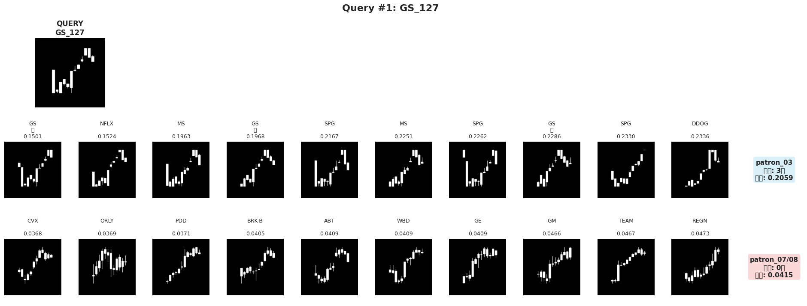

[한국어 버전](README_ko.md)

# Patron — Chart Pattern Similarity Search

[](https://www.python.org/)
[](https://pytorch.org/)
[](https://fastapi.tiangolo.com/)
[](LICENSE)

> Enter a US stock ticker — Patron fetches the latest 12-week chart, finds the three most visually similar historical patterns across 172 stocks, and shows you what happened next.

*Patron* means "pattern" in Spanish.

---

## Overview

Patron is an educational tool for retail investors. Rather than relying on complex technical indicators, it answers one simple question: **"Has this chart pattern appeared before, and what followed?"**

The system encodes chart images as 512-dimensional embeddings using a fine-tuned ResNet18, searches about 48,000 historical patterns, and returns the top-3 most similar ones — designed to come from different tickers (see [Known issue](#known-issue)) — along with 3-, 6-, and 12-month forward returns.

**This is an educational tool, not investment advice.**

---

## Context

Patron is the chart pattern similarity module of **Dipping**, an AI-powered stock education platform for retail investors built at QuantrumAI — a startup club at Dankook University selected for the **U300 Government Startup Program** (certified by the Ministry of Education).

Dipping was built by a six-person team. Patron was my part: as the ML engineer at QuantrumAI (July–December 2025), I built its full AI pipeline alone — data collection, model training, FAISS indexing, and FastAPI serving.

---

## Key Design Choices

| Component | Choice | Why |
|-----------|--------|-----|
| Backbone | ResNet18 (ImageNet pretrained) | Lightweight; strong spatial feature extraction |
| Training | Triplet Loss + Semi-hard Negative Mining | Learns relative similarity, not classification |
| Normalization | MinMaxScaler (per-pattern) | Preserves the visual chart shape; Log normalization distorted it (see Exp 3) |
| Search | FAISS IndexFlatL2 (exact L2) | Exact search over ~48k embeddings. The FastAPI server runs the same exact L2 computation in NumPy |
| Dedup | Ticker-level | Keeps one stock from filling the whole Top-3 |

The most important finding: **Log normalization looked better on paper but distorted chart shapes**, so the model retrieved patterns that were close in numbers but did not look alike. MinMaxScaler was ultimately adopted. See `ARCHITECTURE.md` for the full experiment log.

---

## Dataset

- **Source**: [yfinance](https://github.com/ranaroussi/yfinance) — 172 US stocks (NASDAQ 100 + S&P 100, deduplicated)
- **Period**: 2020-01-01 to 2025-10 (weekly OHLC, auto-adjusted for splits)
- **Patterns**: ~50,000 patterns via 12-week sliding window
- **Metadata**: ticker, sector, industry, pattern dates, 3/6/12-month forward returns

Raw CSVs (172 files, ~4 MB) are included in `patron_fastapi/data/raw/`. Model weights (`.pth`) and image arrays (`.npy`, `.tar`) are stored on Google Drive and are **not included** in this repository.

---

## Notebooks

Run in order to reproduce training from scratch:

| # | Notebook | Description |
|---|----------|-------------|
| 01 | `01_preprocessing.ipynb` | Download OHLC data → sliding window → MinMaxScaler → grayscale chart images |
| 02 | `02_training_v1.ipynb` | ResNet18 + Triplet Loss training (**final model**; A100: ~5h to generate chart images + ~1.5h training) |
| 03 | `03_faiss_search.ipynb` | Build FAISS index, implement ticker-dedup Top-3 search |
| 04 | `04_normalization_compare.ipynb` | MinMaxScaler vs Log normalization analysis (Exp 2) |
| 05 | `05_preprocessing_v2.ipynb` | Log-normalization preprocessing (Exp 3 — ultimately rejected) |
| 06 | `06_training_v2.ipynb` | ResNet18 training with Log normalization (Exp 3 — rejected) |
| 07 | `07_visual_comparison.ipynb` | Side-by-side visual comparison of Exp 1 vs Exp 3 |
| 08 | `08_realtime_search.ipynb` | Real-time search demo using live yfinance data |
| 09 | `09_embedding_precompute.ipynb` | Pre-compute and save the ~48k searchable embeddings (patterns with a 3-month forward return) for FastAPI |

> Notebooks 04–07 document the normalization experiment. They are not required to run the final model but explain why MinMaxScaler was chosen.

---

## FastAPI Server

`patron_fastapi/main.py` exposes a single endpoint:

```
POST /api/patron/search
Body: ticker (str, e.g. "AAPL")
```

**What it does:**
1. Validates the ticker against the US stock market (via yfinance)
2. Fetches the latest 12 weeks of OHLC data in real time
3. Converts it to a grayscale chart image
4. Runs inference with the ResNet18 embedding model
5. Computes the exact L2 distance to all ~48k stored embeddings — the same result as the FAISS IndexFlatL2 index built in notebook 03 — and picks the Top-3
6. Returns metadata including sector, dates, and forward returns

**Dependencies** (see `patron_fastapi/requirements.txt`):

```bash
cd patron_fastapi
pip install -r requirements.txt

# Model weights must be placed at:
# patron_fastapi/models/best_model.pth     (ResNet18)
# patron_fastapi/data/embeddings.npy       (~48k embeddings)
# patron_fastapi/data/faiss_index.bin      (FAISS index, loaded at startup)
# patron_fastapi/data/metadata_all.csv     (pattern metadata)

uvicorn main:app --host 0.0.0.0 --port 8000
```

See `patron_fastapi/SERVER.md` for the full setup guide.

<a id="known-issue"></a>
**Known issue:** Ticker-level deduplication in the server does not work as intended. The `seen_tickers` set is
checked but never updated, so the same ticker can appear more than once in the Top-3 (for example, the same stock
from two consecutive months).

---

## Results

| Experiment | Normalization | Avg. Duplicate Tickers | Avg. L2 Distance | Visual Quality |
|------------|---------------|------------------------|------------------|----------------|
| Exp 1 — **adopted** | MinMaxScaler | 2.20 | 0.196 | **Visually similar** ✅ |
| Exp 3 — rejected | Log | 0.15 | 0.061 | Numerically closer but visually different ❌ |

Despite better numeric metrics, Exp 3 failed the visual inspection test. Exp 1 (MinMaxScaler) was adopted as the final model, with ticker-deduplication applied at search time.

<p align="center">
  
</p>

*Query #1 (GS) from `07_visual_comparison.ipynb`. **Top row — Exp 1, MinMaxScaler (adopted):** larger L2 distances
(0.15–0.23), but the results keep the query's shape: a sharp drop, then a step-by-step climb.
**Bottom row — Exp 3, Log (rejected):** much smaller distances (~0.04) and no duplicate tickers, but the results are
gentle uptrends that do not look like the query. The better metric was measuring the wrong thing.
(Labels in the image use the original notebook names: patron_03 = Exp 1, patron_07/08 = Exp 3.)*

---

## Project Structure

```
patron/
├── notebooks/
│   ├── 01_preprocessing.ipynb        # Data collection & preprocessing
│   ├── 02_training_v1.ipynb          # Final model training (ResNet18 + Triplet Loss)
│   ├── 03_faiss_search.ipynb         # FAISS index + Top-3 search
│   ├── 04_normalization_compare.ipynb # MinMaxScaler vs Log analysis
│   ├── 05_preprocessing_v2.ipynb     # Log normalization preprocessing
│   ├── 06_training_v2.ipynb          # Log normalization training (rejected)
│   ├── 07_visual_comparison.ipynb    # Visual comparison of Exp 1 vs Exp 3
│   ├── 08_realtime_search.ipynb      # Live demo with yfinance
│   └── 09_embedding_precompute.ipynb # Pre-compute embeddings for FastAPI
├── patron_fastapi/
│   ├── main.py                       # FastAPI server
│   ├── requirements.txt
│   ├── SERVER.md                     # Setup & deployment guide
│   └── data/
│       ├── metadata_all.csv          # Pattern metadata (50k rows)
│       └── raw/                      # 172 ticker CSVs (~4 MB total)
├── ARCHITECTURE.md                   # Full design doc & experiment log
└── .gitignore
```

**Not included** (stored on Google Drive):
- `best_model.pth` — trained ResNet18 weights
- `embeddings.npy` — ~48k precomputed embeddings
- `faiss_index.bin` — FAISS index
- `images.tar` / `images_v2.tar` — chart image archives (~2.4 GB each)

---

## License

MIT License — see [LICENSE](LICENSE)
